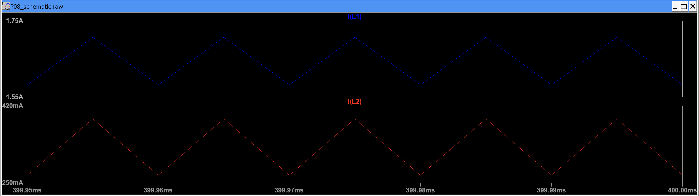
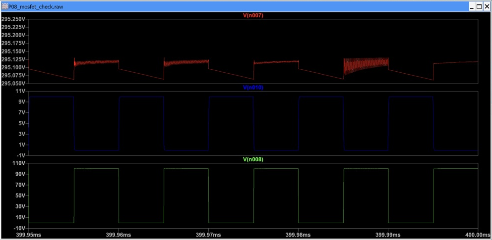
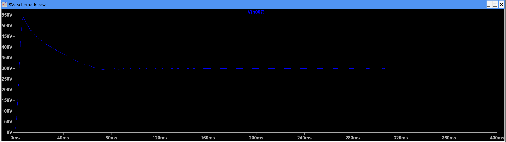

# Triple Voltage-Lift Luo Converter

**50 V in · 299.45 V out · LTspice replication and analysis**

A study of a modified Luo DC–DC converter: derive its operating equations, reconstruct the power stage in LTspice, and test how duty cycle and device losses change its behavior.

**[Read the report](report/report.pdf)** · **[Run the simulations](docs/reproduction.md)** · **[Explore the results](results/measurements.csv)**


*Original LTspice capture: both inductor currents remain positive over five settled switching periods.*

## What I investigated

The triple voltage-lift topology from [Gholizadeh et al., IECON 2024](https://doi.org/10.1109/IECON55916.2024.10905089) combines two inductors, five diodes, a capacitor lift network, and one controlled switch. Under ideal continuous-conduction assumptions, its voltage gain is:

$$\frac{V_o}{V_{in}}=\frac{3}{1-D}$$

At 50% duty, the predicted output is six times the input. This project checks more than the output voltage: intermediate capacitor voltages, inductor currents, ripple, switching stress, and input/output power are compared with the analysis.

## Results at a glance

| Near-ideal case | Ideal output | LTspice output | Error | L2 ripple, peak-to-peak |
|---|---:|---:|---:|---:|
| 30% duty | 214.286 V | 213.973 V | −0.146% | 74.83 mA |
| 50% duty | 300.000 V | 299.452 V | −0.183% | 124.73 mA |
| 60% duty | 375.000 V | 374.414 V | −0.156% | 149.72 mA |

All three cases use a 50 V source, 100 kHz switching, 2 mH inductors, 50 uF capacitors, and a 909.09 ohm load. Holding resistance fixed changes output power as duty changes; these are not constant-power comparisons.

The final MOSFET model gives **295.10 V**, **95.79 W** output, and **97.58% simulated efficiency**, including the gate-source power. These numbers apply to the selected models and assumed parasitics; they are not hardware measurements.

## The most interesting finding

The paper's printed second-inductor ripple expression contains a `(1-D)` factor, while substitution into its switching-state equations gives `D`. Both agree at 50% duty. Testing at 30% and 60% distinguishes them: the saved simulations agree with the `D` expression. The report treats this as an **apparent typographical inconsistency**, supported by the derivation and these cases, rather than a confirmed author erratum.

## From ideal switch to MOSFET


*Final 50 ns check: output ripple, gate drive, and drain voltage across five switching periods. These are original LTspice traces.*

The model progression is:

1. **Near-ideal baseline:** establish gain, capacitor voltages, and continuous conduction.
2. **Duty-cycle tests:** check the gain and ripple equations away from the reference point.
3. **Conduction-loss model:** introduce illustrative winding resistance, capacitor ESR, switch resistance, and diode drops.
4. **MOSFET model:** use IPP600N25N3 with a 10 ohm gate resistor.
5. **Numerical check:** reduce maximum timestep from 100 ns to 50 ns and disable waveform compression.

## Startup matters



The near-ideal output briefly reaches approximately **540 V** before settling near **300 V**. The measured switch maximum is **100.07 V** after settling but **202.19 V** during startup. This demonstrates why steady-state gain alone is insufficient for component selection.

## Reproduce and inspect

- Open a `.asc` file in [`ltspice/`](ltspice/) and run through 400 ms.
- Compare the measurement log with [`results/measurements.csv`](results/measurements.csv).
- Follow the [reproduction guide](docs/reproduction.md) for model dependencies, plot nodes, time ranges, and report compilation.
- Run `python3 scripts/check_results.py` to check archived settings and regenerate the CSV. This checks saved evidence; it does not run the simulator.

```text
ltspice/          Six schematics and final plot settings
results/          Original waveform crops, saved logs/netlists, measurement CSV
report/           LaTeX source, source figures, and compiled report
scripts/          Archived-settings and results checker
docs/             Reproduction instructions and attribution
```

## Scope and limitations

This is a student simulation replication of the **triple** converter. No physical prototype was built. The higher-gain variants are discussed analytically. The model omits magnetic saturation/core losses, full diode reverse recovery, thermal behavior, and layout parasitics. The final numerical comparison changes timestep and compression together, so it does not establish controlled timestep convergence. High-frequency ringing remains model- and solver-dependent.

Useful follow-up work would isolate numerical settings, test soft-start and current limiting, and sweep load to identify the CCM/DCM boundary.

## Author and reference

**Aly Hany Rakha** · CO-526 Electronics Laboratory · October 2026

H. Gholizadeh, M. Dehghan, G. B. Gharehpetian and A. Yazdani, *Triple, Quadruple, and Hextuple Voltage-Lift Modified Luo Converters Suitable for Renewable Applications*, IECON 2024. [DOI: 10.1109/IECON55916.2024.10905089](https://doi.org/10.1109/IECON55916.2024.10905089).

See [sources and attribution](docs/attribution.md) for project provenance, AI assistance, and third-party material. The original paper and manufacturer model libraries are not redistributed.
